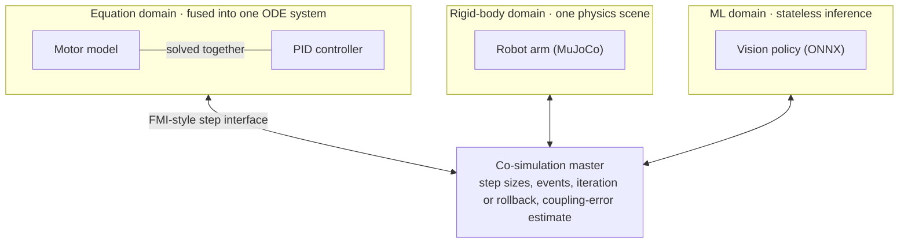

# Block contract

_Last updated: 2026-10-15_

Every simulation, from a pendulum to a CFD solver to a neural network, is wrapped as a **Block**. Blocks in the same domain are fused and solved together using that domain's native approach; different domains are coupled through an FMI-style step interface run by a co-simulation master. Rationale and rejected alternatives: [ADR 0002](../decisions/0002-layered-block-contract.md). Code: `crates/simsandbox-core/src/block.rs`.

## What a Block declares (`BlockSpec`)

| Field | Meaning | Implemented |
| --- | --- | --- |
| Domain | Equations, rigid body, agents, fields, ML or external; decides how it is fused | Yes (`Domain`) |
| Ports | Typed inputs and outputs with SI unit and shape, e.g. `velocity: Vector(3) [m/s]`; an output may declare itself the coordinate of another along a grid axis (ADR 0024) | Yes, scalar, vector, grid and point-set signal ports (`PortSpec`) |
| Parameters | Named, unit-aware, with default, suggested range, description and an `initial_condition` flag (applies on restart); become entry fields and optional sliders ([ADR 0011](../decisions/0011-parameter-entry.md)) | Yes (`ParamSpec`) |
| State | Named variables owned by the kernel as a flat `f64` slice, so snapshots and rewind work uniformly; external Blocks must save and restore their own | Kernel-owned state, yes |
| Tables | Named populations of rows (columns of `f64`, a stable id per row) that grow and shrink, owned by the kernel beside the fixed state and included in snapshots ([ADR 0034](../decisions/0034-agent-domain.md)) | No (planned, Phase 1) |
| Time semantics | Continuous with events (as in FMI 3.0); fixed-step, discrete-event and stateless as special cases | Declared (`TimeSemantics`); the master only uses fixed communication steps today |
| Method | The method being run, with speed and accuracy labels | Yes (`MethodSpec`, `MethodLabels`) |

## Model definition and methods

A Block separates **what** is simulated from **how** it is computed. The model definition (equations or rules, ports, parameters, state) is written once; one or more methods compute it, each with its own settings and labels ([method classification](method-classification.md)). Light models offer several methods, so switching RK4 for an adaptive solver is a setting (`OdeBlock::set_integrator`). Heavy models may offer only one. Surrogates and reduced-order models are additional, labelled methods.

## Traits

| Trait | Required | What the Block provides | What the kernel does with it | Implemented |
| --- | --- | --- | --- | --- |
| `Block` | Yes | Spec, method, `init`, `do_step`, `compute_outputs` | Steps it as a co-simulated black box | Yes |
| `Equations` | No | `rhs` (dx/dt) and `outputs` | Fuses it with other equation Blocks into one system | Yes |
| `Rollback` | No | Cheap undo of a rejected step | Iterative coupling and step rejection | Trait only |
| `Derivatives` | No | Jacobian of the right-hand side | Implicit coupling, sensitivities, parameter fitting | Trait only |
| `Realtime` | No | Guaranteed worst-case step time | Admits it into real-time models | Trait only |

Capabilities are discovered through `as_equations()`, `as_rollback()`, `as_derivatives()` and `as_realtime()`, which default to `None`. How users define their own Blocks without rebuilding (Python, WebAssembly, Julia) is decided later ([Q28](../open-questions.md), [ADR 0038](../decisions/0038-phase-1-revised.md)); any such Block keeps its state in the kernel. Out-of-process Blocks (OpenFOAM, Julia, untrusted code) will implement the same traits through a gRPC adapter.

## Coupling

- **Within a domain**, Blocks are merged into one problem, so tightly coupled equations have no coupling error. Implemented for equations in two ways:
  - **Fused groups in the master** ([ADR 0023](../decisions/0023-automatic-fusion.md), `crates/simsandbox-core/src/fusion.rs`): `Model::fuse(members, solver)` marks continuous equation Blocks to be advanced together. The members stay ordinary Blocks (ids, ports, parameters, states, snapshots unchanged); each step the kernel concatenates their states, builds one right-hand side from their `Equations` with connections inside the group resolved at every evaluation (inputs from outside are held over the step), and hands it to the group's `GroupSolver`, which the domain registers (`Registry::register_group_solver`; for equations, `GroupIntegrator`). Model files fuse automatically: connected continuous equation blocks with identical method settings form a group; `"fusion": "off"` turns this off and `"groups"` fuses chosen blocks with a chosen method.
  - **`EquationGroup` → `FusedSystem`** in code: a composite system wrapped in one `OdeBlock`, exposing `<member>.<name>` ports and parameters (used for subsystems).
- **Across domains**, each Block or fused group presents the step interface (set inputs, `do_step(dt)`, get outputs, save and restore state). Implemented: fixed step, Jacobi exchange. Planned: adaptive steps, events, iteration, rollback, coupling-error estimates.
- **The UI marks cross-domain connections** with their estimated coupling error (planned).
- **FMI 3.0 at the edges**: fused groups exportable as FMUs; FMUs importable as external Blocks (planned, Phase 2).

Measured effect (test `cosimulation_adds_coupling_error`): two coupled oscillators over 10 s stay within about 2×10⁻⁹ of the exact solution when fused with RK4, and drift by about 1×10⁻² when co-simulated with a 0.01 s communication step.

## Connections

| Kind | Rule | Implemented |
| --- | --- | --- |
| Signal (causal) | Output drives input; any domain; across domains through the master | Yes |
| Physical (acausal) | Across/through pairs (voltage–current, force–velocity); only between equation Blocks, compiled into the fused system; crossing a domain boundary requires choosing a causality | No |
| Field coupling | Always cross-domain, explicit mesh mapping, conservative interpolation where required | No |
| Checks | Direction, shape and unit dimension checked at connect time; compatible scales converted automatically; each input connected at most once | Yes |

## Composition

- A group of connected Blocks can be collapsed into a new Block with its own exposed ports and parameters (equation domain: `FusedSystem` exposes `<member>.<name>` ports and parameters).
- The saved model will be a JSON file naming each Block by a registered type ([ADR 0007](../decisions/0007-json-model-files.md)), with an optional `controls` section for sliders, playback speed, default plots and the opening view ([ADR 0012](../decisions/0012-controls-in-model-files.md), [ADR 0014](../decisions/0014-view-in-controls.md)).

## Current restrictions

- Fused-group members must have no direct feedthrough (outputs depend on state and parameters only); see [Q5](../open-questions.md).
- `Shape` supports scalars, vectors, grids (`Grid { nx, ny }`, row-major) and point sets (`Points { count, dim }`); point sets of variable length are planned for populations ([ADR 0034](../decisions/0034-agent-domain.md)); tensors and meshes come with their domains.
