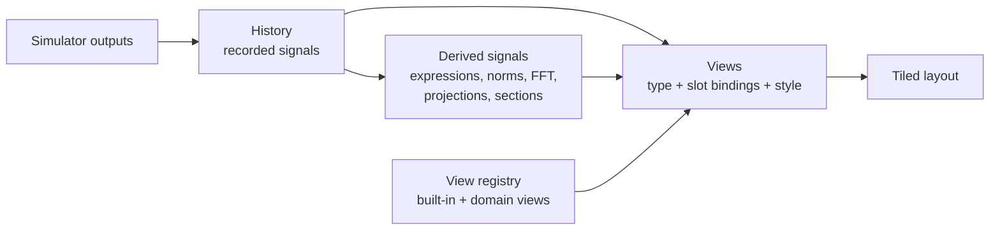

# Visualization architecture

_Last updated: 2026-10-16_

How the app turns a running model into pictures. Decision and rationale: [ADR 0015](../decisions/0015-pluggable-views.md). Status: the three built-in views exist in `crates/simsandbox-app` (`app.rs`, `view3d.rs`); the registry, slots, derived signals and multi-view layout below are planned, in the order of the migration steps at the end.



## Signals

A **signal** is a named quantity recorded over time.

| Kind | Example name | Source |
| --- | --- | --- |
| Scalar | `a.x`, `lorenz.xyz[0]`, `t` | An element of an output port, or time |
| Vector | `lorenz.xyz` | A whole vector output |
| Grid | `heat.temperature` | A grid output (planned kernel shape) |
| Point set | `flock.positions` | N points of dimension d (planned kernel shape) |
| Derived | `energy`, `fft(a.x)`, `pca(state)[0]` | Computed from other signals; presentation only |

Names follow the model file conventions: `block.port` for a whole output, `block.port[i]` for one element ([ADR 0014](../decisions/0014-view-in-controls.md)). The history records every signal at every communication step and is thinned, rewound and branched as a whole, so signals always pair by index.

Derived signals are defined in `controls` because they change only what is shown, never results. Expressions use the parser chosen for symbolic equation entry ([Q4](../open-questions.md)).

## Views

A view type declares:

| Part | Meaning | Example (`plot.phase`) |
| --- | --- | --- |
| Name | Namespaced like block types | `plot.phase` |
| Slots | Named inputs, each accepting some signal kinds; required or optional | `x`: scalar, `y`: scalar, `colour`: scalar (optional) |
| Style properties | Declared like parameters: name, default, suggested range, description | `trail_length` (s), `line_width` |
| Drawing | Draws from the bound signals into a region of the window | egui_plot line, or egui painter, or a wgpu paint callback |

Planned built-in types: `plot.time`, `plot.phase`, `plot.3d`, `plot.heatmap` (grid over time or space), `plot.scatter` (point sets), `plot.spectrum`. Domain types: `eq.pendulum`, rigid-body scenes, field surfaces, agent maps.

Rendering technology follows the data size: egui_plot and the egui painter for lines up to tens of thousands of points; wgpu paint callbacks ([ADR 0008](../decisions/0008-native-egui-ui.md)) for meshes, fields and large point sets. GPU views are tested on software drivers ([development setup](../guides/development-setup.md#testing-gpu-code-without-a-gpu)).

## Style

| Layer | Who it serves | Where it lives | Examples |
| --- | --- | --- | --- |
| Encodings | The author: what the picture shows | Slot bindings in `controls` | Colour or opacity by `t` (trail fading), colour by speed |
| Style properties | The author: readability of this model | Declared per view type; values in `controls` | Trail length, point size, line width |
| Theme | The viewer | App settings, never in model files | Colour-blind-safe palette (default), light or dark, global line-width scale |
| Fixed defaults | Nobody needs to change them | Code | Grid style, marker shapes, fonts |

Rule for adding an option: it must change what can be read (make it a slot) or be needed for some model's readability (make it a style property), and an example or user need must show it. Purely aesthetic choices stay fixed.

## Default views

When a file names no views, the app picks from output shapes and roles: a 3-vector or three scalars with a position role give `plot.3d`; a grid gives `plot.heatmap`; a point set gives `plot.scatter`; otherwise `plot.time`. A domain can register a preferred view for its block types.

## Model file representation (planned)

```json
"controls": {
  "views": [
    { "type": "plot.3d",
      "bind": { "x": "lorenz.xyz[0]", "y": "lorenz.xyz[1]", "z": "lorenz.xyz[2]", "colour": "t" },
      "style": { "trail_length": 20.0 },
      "camera": { "yaw": -0.6, "pitch": 0.35, "zoom": 1.0 } },
    { "type": "plot.time", "bind": { "y": ["lorenz.xyz[0]", "lorenz.xyz[2]"] } }
  ],
  "layout": "columns",
  "signals": { "energy": "0.5 * (a.v^2 + b.v^2)" }
}
```

Like the rest of `controls`, invalid entries are dropped with a warning ([ADR 0012](../decisions/0012-controls-in-model-files.md)). The current `controls.view` maps directly: `kind` to `type`, `axes` to the `x`, `y`, `z` slots.

## Crates

| Crate | Contents | Depends on |
| --- | --- | --- |
| `simsandbox-views` (planned) | View trait, registry, history and derived signals, built-in views, palette | `simsandbox-core`, egui, egui_plot, wgpu |
| Domain crates, feature `views` | Model-specific views, registered next to block types | `simsandbox-views` (optional) |
| `simsandbox-app` | Layout, panels, app settings | All of the above |

## Migration steps

1. Move the history (`Session` series) and the three current views into `simsandbox-views` behind the view trait and registry; no behaviour change.
2. Replace `controls.view` with `controls.views` (one entry), keep reading `view`; add a colour slot to `plot.phase` and `plot.3d` with trail fading as its default binding to `t`, and `trail_length` as the first style property.
3. Several views at once in a tiled layout.
4. Derived signals (expressions after Q4; norms, FFT, projections, Poincaré sections).
5. Grid and point-set shapes in the kernel, `plot.heatmap` and `plot.scatter`, with the first field or agent Block.
6. First domain view (`eq.pendulum`) with a pendulum example, proving the registration path.
