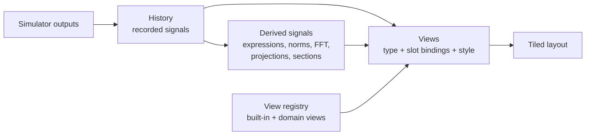

# Visualization architecture

_Last updated: 2026-11-19_

How the app turns a running model into pictures. Decision and rationale: [ADR 0015](../decisions/0015-pluggable-views.md). Status (2026-10-18): migration steps 1–6 are done. ADRs 0024 (heat map axes and coordinates), 0025 (index-aware settings), the filter layer (ADRs 0030–0032) and sweeps as samples (ADRs 0027–0028) were built; since 2026-11-04 sweeps are studies, their results fields like any other ([ADR 0071](../decisions/0071-sweeps-are-studies.md)).

## Filters

Data flows sources → filters → views ([ADR 0030](../decisions/0030-filters-and-native-visualization.md)). Filters are saved in `controls.filters`; each has a `name`, a `type`, the `inputs` it reads and its settings, and the order carries no meaning ([ADR 0032](../decisions/0032-filters-as-a-graph.md)). They are evaluated with every recorded sample (`crates/simsandbox-app/src/filters.rs`, used by `Session`), so their results rewind, thin and branch with the history; editing them replays the recorded sources. Two types exist:

- `expression`: a derived signal over recorded signals, other expressions (evaluated in dependency order; cycles are dropped), parameters and `t`. The older `controls.signals` is converted on load.
- `cut` ([ADR 0031](../decisions/0031-cut-filters.md), `crates/simsandbox-views/src/cut.rs`): through one 2D grid, along x at fixed y values, along y at fixed x values, or along free lines (extended to the grid's edges by default), with bilinear or nearest interpolation. It records one line field per cut (`name[k]`, labelled e.g. `spring.c = 0.05`) and their shared coordinate (`name.x`, `name.y` or `name.fraction`). Profiles saved with ADR 0029 cuts are converted into cut filters on load.

The "Data…" window lists and edits all filters; a new cut filter opens a profile of its cuts. Filters that work on a window of history (FFT, smoothing, sections) are not built yet; they will not fit the per-sample evaluation and need their own path. The node canvas shows the same filters, and the views, as its data layer ([ADR 0050](../decisions/0050-data-layer-and-canvas-undo.md), `crates/simsandbox-session/src/observers.rs`), where they are wired, edited and promoted to model blocks. Field views are in `crates/simsandbox-views/src/fields.rs`. `crates/simsandbox-views` holds the history, the view contract and registry (`view.rs`), colour encodings (`colour.rs`) and the built-in views (`builtin.rs`, `view3d.rs`); the app shows the model's views as tiles in an automatic grid, with "More views…" for any other view that fits ([ADR 0016](../decisions/0016-model-curated-views.md); `crates/simsandbox-session/src/views.rs`). Derived signals and field recording are in `crates/simsandbox-session/src/session.rs` and `filters.rs`; views and the node canvas also render headless (`render.rs`, [ADR 0041](../decisions/0041-headless-interface.md)). The first domain view, `eq.pendulum`, lives in `crates/simsandbox-eq/src/views.rs` behind the crate's `views` feature. The viewer theme is planned.



## Signals

A **signal** is a named quantity recorded over time.

| Kind | Example name | Source |
| --- | --- | --- |
| Scalar | `a.x`, `lorenz.xyz[0]`, `t` | An element of an output port, or the index `t`: time |
| Vector | `lorenz.xyz` | A whole vector output |
| Grid | `rod.temperature` | A whole `Shape::Grid { nx, ny }` output, recorded as one frame per sample |
| Point set | `disc.positions` | A whole `Shape::Points { count, dim }` output (`[x0, y0, x1, y1, …]`), recorded as one frame per sample |
| Population | `sheep.position` | A `Shape::Population { dim }` output: points whose number varies, recorded as one frame per sample of its own length (`FieldShape::Population`); the history counts the values held when thinning, keeping at least 1000 samples |
| Rows | `pop.size` | A `Shape::Rows { dim }` output, a table's rows ([ADR 0079](../decisions/0079-tables-of-members.md)): recorded as one frame per sample with the table's version and the rows' ids (`FieldShape::Rows`), followed by id (`Field::by_id`); counted like populations; not drawn by views yet |
| Derived | `energy`, `fft(a.x)`, `pca(state)[0]` | Computed from other signals; presentation only |

Names follow the model file conventions: `block.port` for a whole output, `block.port[i]` for one element ([ADR 0014](../decisions/0014-view-in-controls.md)). The history records every signal at every communication step and is thinned, rewound and branched as a whole, so signals always pair by index. Grids and point sets are recorded whole and are not split into scalars; when a model has fields, the history keeps at most 4 000 000 field values (but at least 1000 samples) before thinning. Derived signals cannot use fields yet.

Derived signals are defined in `controls.signals` because they change only what is shown, never results. Expressions use the typed-equation parser ([ADR 0017](../decisions/0017-typed-equations.md)) with dotted names: plotted signals (`a.v`, `lorenz.xyz[0]`), parameters (`a.kappa`) and `t`. They are evaluated with the parameter values current when each sample is recorded; redefining them recomputes the history with current values.

## Views

A view type declares:

| Part | Meaning | Example (`plot.phase`) |
| --- | --- | --- |
| Name | Namespaced like block types | `plot.xy` |
| Slots | Named inputs, each accepting one kind (scalar, grid or point set); required or optional | `x`: one signal (default `t`), `y`: one or more, `colour`: one (optional) |
| Presets | Named starting bindings offered in "More views…" | "Plot against time", "Phase portrait" |
| Style properties | Declared like parameters: name, default, suggested range, description | `trail_length` (s; 0 no trail, -1 the whole run), `line_width` |
| Drawing | Draws from the bound signals into a region of the window | egui_plot line, or egui painter, or a wgpu paint callback |

Built-in types: `plot.xy` (any signals against time or each other, [ADR 0018](../decisions/0018-one-xy-plot.md); bound to lines of cells of equal length, such as a study's results, it draws their newest frames against each other cell by cell as points coloured by the `colour` line, preset "Cell by cell", [ADR 0071](../decisions/0071-sweeps-are-studies.md)), `plot.3d`, `plot.heatmap` (a field over two axes, [ADR 0024](../decisions/0024-heat-map-axes-and-coordinates.md), with an optional `points` slot that draws a point set's or population's newest points over the map in its coordinates, e.g. sheep on their grass: `x` and `y` each take `t` (for a line of cells) or a coordinate of the field; unbound axes take the remaining directions by cell number; a "swap axes" button exchanges them; coordinates may be unevenly spaced or decreasing, and are resampled so each cell reaches halfway to its neighbours; a 2D grid shows its newest frame; colours scaled to the shown values, linearly or with `log_colour` = 1 logarithmically), `plot.profile` (the newest frame of line fields against their coordinate, its value axis spanning every value seen so the curve moves, not the axis; cuts through 2D grids come from cut filters) `plot.scatter` (a point set's newest frame, first two coordinates), `plot.surface`, `plot.contour` and `plot.values` (the newest value of each bound signal as a number with its unit, and lines of cells such as a study's results as a table, cell by cell: for models evaluated, not run, [ADR 0072](../decisions/0072-models-with-nothing-in-time.md); units come from the outputs' ports through `History::unit`); planned: `plot.spectrum`. Surfaces and contours take the heat map's slots and lay the field over its axes the same way (`fields::sheet`), so they show 2D grids over their coordinates and lines of cells over time: `plot.surface` draws heights in a box (axes normalised to [-1, 1], height to ±0.7) as quads coloured by value, shaded by slope and sorted furthest first (the painter's algorithm, at most 40 000 quads, outlined below 2 500), fitted to the current rotation, with the axis ranges in the labels; `plot.contour` draws `levels` lines evenly spaced strictly inside the value range by marching squares (linear interpolation along cell edges, saddles split by the cell mean, segments joined into lines), both with a `log_scale` style property. Domain types: `eq.pendulum` (the rod and bob, with a fading path); planned: field surfaces, agent maps. Pictures made of parts are `plot.scene` ([Scenes](#scenes)).

Each binding names its recording ([ADR 0063](../decisions/0063-probes-on-wires.md)): `car.v` is the model's, recorded at every step (thinned when long), and `probe:speed/car.v` probe `speed`'s, recorded when the probe records. A view draws from `Recorded` (the model's history and each probe's); `ViewInput` resolves each binding in its own recording. Against `t`, each curve uses its own times; where a view pairs signals from different recordings (x against y, a 3D path, colour), `history::paired` keeps only the times all of them recorded. The model's history records only what views and filters read from it (`Session::set_view_reads`), so a signal wired during a run has no past until it is recomputed on request (`Session::recompute`, the run bar's **Fill the past**: a replay from a snapshot, bit for bit).

A view type may offer "swap axes" (`ViewType::swap`): a heat map exchanges its `x` and `y` bindings; `plot.xy`, whose `y` may hold several signals, draws transposed instead and saves that in its `selection`.

Coordinates are fields too: an output port may declare itself the coordinate of another output along a grid axis (`PortSpec::coordinate_of`, once per output; `eq.heat_rod` declares `position` for `temperature`, and a typed-equation grid's axis is the coordinate of every array on it, [ADR 0060](../decisions/0060-arrays-in-typed-equations.md)), and a study over a grid of two parameters gives each parameter as a 2D coordinate of every result ([ADR 0071](../decisions/0071-sweeps-are-studies.md)). The history lists them (`History::coordinates`), axis pickers offer only `t` (for lines) and the bound field's coordinates, and a saved binding that cannot place the field is dropped with the reason. Slots and style properties declare where they apply (`applies`, [ADR 0025](../decisions/0025-index-aware-view-settings.md)); the panel hides the rest and views use their defaults there, so `trail_length` does nothing in a history indexed by something other than time (none since sweeps became studies, ADR 0071). Views skip infinite and NaN values, leaving gaps (`finite_runs`). `plot.xy` and `plot.profile` span at least `MIN_RELATIVE_SPAN` (10⁻⁶) of the largest magnitude shown, so a conserved quantity is drawn flat rather than magnified to rounding noise; it is a fixed default, not a style property.

Sweeps are studies ([ADR 0071](../decisions/0071-sweeps-are-studies.md)): every history is indexed by time, and a study's results are fields recorded at each step like any other. A grid over one parameter gives lines of cells drawn by `plot.profile` against the parameter; a grid over two gives 2D fields for heat maps, surfaces, contours and cuts; any other design gives lines indexed by run, which `plot.xy` draws cell by cell ("Cell by cell"). A model holding a study opens on a profile of its results, or on a heat map for 2D results.

A view type lists the block types it applies to (`applies_to`, empty for generic views). A view that does not apply is neither offered under "More views…" nor restored from a file ([ADR 0016](../decisions/0016-model-curated-views.md)). What a model offers views is passed as `Available`: its scalar signals, grids, point sets and block types.

Fields of any number of axes are drawn by role ([ADR 0086](../decisions/0086-views-by-axis-roles-and-mesh-views.md), ADR 0081 stage 3): a heat map, surface or contour draws two of a field's axes (chosen by its `x` and `y` coordinates, else the first two) and a profile one; each axis left over is picked at a place (a slider in the tile), reduced (`mean`, `minof`, `maxof`, `sum`) or shown as facets (small panels on one colour scale; curves in a profile), saved as the view's `selection` (`crates/simsandbox-views/src/slice.rs`). Axis names come from the ports (`History::axes`).

Meshes reach views through their ports ([ADR 0086](../decisions/0086-views-by-axis-roles-and-mesh-views.md)): a table of cells is an output of each cell's corners declaring `PortSpec::mesh`, the history knows each mesh's polygons and coordinates (`History::mesh`), and `plot.mesh` (`crates/simsandbox-views/src/mesh.rs`) builds triangles on the CPU from the newest frame and fills 2D cells, draws a 3D mesh's outer surface, or draws its section by a plane in any direction (`mesh::section`, saved as the view's `cut`: a normal and a place along it). Fields over a table's rows are coordinates of each other, paired by id.

Rendering technology follows the data size: egui_plot and the egui painter for lines up to tens of thousands of points; wgpu paint callbacks ([ADR 0008](../decisions/0008-native-egui-ui.md)) for meshes, fields and large point sets. Meshes are the first ([ADR 0086](../decisions/0086-views-by-axis-roles-and-mesh-views.md) step 4d): `simsandbox-views`' `gpu` feature (enabled by the app, installed at start with `gpu::install`) renders `plot.mesh`'s triangles into a texture of its own with a depth buffer and puts it on screen; without it (headless renders, Python) the same triangles are drawn by egui, sorted furthest first. GPU views are tested on software drivers ([development setup](../guides/development-setup.md#testing-gpu-code-without-a-gpu)).

## Scenes

`plot.scene` ([ADR 0093](../decisions/0093-scenes-from-primitive-layers.md), drawn as [ADR 0101](../decisions/0101-scene-primitives-are-parametric-meshes.md) says; `crates/simsandbox-views/src/scene/`) is one view type whose picture is an ordered list of **layers**, each one **primitive** whose **attributes** are bound to a constant, a scalar signal (one instance, its newest value), a quantity over a table's rows (one instance a row; a layer's rows and its frame's pair by id) or a model parameter (`bob.L`, [ADR 0102](../decisions/0102-scene-bindings-may-name-parameters.md): where no signal has that name, a signal winning; its value at the drawn sample). Built through stage 3 (editing) on 2026-11-19: see the ADR's "Stage 1 built", "Stage 2 built", "Stage 3 built" and "Parameters, frame renames and errors".

- **Declared** (`scene/spec.rs`): `points` (`x`, `y`; `size` 6 pt, `colour`), `segments` (`x1`, `y1`, `x2`, `y2`; `width` 2 pt, `colour`), `boxes` (`x`, `y` the centre, `angle` 0, `width`, `height`; `colour`), `discs` (`x`, `y`, `radius`; `angle`, a mark drawn only when bound; `colour`). Each attribute has a kind: a length in the scene's `unit` (`m` if absent), an angle in radians, screen points, or a colour. `colour` is a number through the scene's colour scale (viridis over 0 to 1, clamped: a model normalises what it shows, so a colour means the same in every frame) or a name from the fixed palette (`black`, `grey`, `white`, `orange`, `sky`, `green`, `yellow`, `blue`, `red`, `purple`: the Okabe–Ito colours and greys); unbound it is `sky`. `simsandbox describe plot.scene` lists all of this under `takes`.
- **Checked** (`Scene::check`), each problem at its path within the view (`layers[2].bind.x: no signal or parameter 'cart.y'`): unknown settings, primitives, attributes, signals and frames; a missing required attribute; a length bound to another length unit (an unknown or dimensionless unit is accepted), an angle to anything but radians or a dimensionless number, a screen size to anything with a unit (a parameter's unit is its declaration's, checked the same way); rows of two tables in one layer (a table is its block and the table its port names); frames in a cycle; a frame over rows holding another, or viewed from. A scene that does not fit is left out with a warning, as other views are; `check` reports it.
- **Frames** (`scene/eval.rs`): named poses `x`, `y`, `angle` in a parent (`in`, the scene's own frame if absent); a point p in a frame lies at origin + R(angle)·p in its parent (`geometry::Pose`); frames chain. A layer's positions and angles are in its frame (`in`); its sizes are unchanged. `view_from` draws the picture in a frame's coordinates. Composed frames agree with the same pose written in typed equations to 10⁻¹² (`frames_agree_with_the_same_pose_in_typed_equations`).
- **One drawing path:** each layer's instances are placed in the scene's frame (`Scene::place`, what grabbing tests with `eval::picked`), seen through `view_from`, and turned into one list of filled triangles (scene units) and lines and dots (screen points) by each primitive's parametric mesh (`geometry::Instance::mesh`: a disc in as many pieces as keep it within 0.2 pt of the circle; also `bounds` and the exact `contains`). The list is kept until the recordings' stamps, the scale (screen points per unit) or the plot's size change; new settings start it over. It is painted by egui's painter as an item of an `egui_plot` plot with equal scales (`data_aspect` 1), so axes, pan, scroll-zoom and double-click reset are the plots' (all paused while an instance is held); the same in the window and headless.
- **Grabbing** (ADR 0093 point 6, ADR 0101 point 3; `scene/mod.rs`): a layer's `grab` names an `input.pointer` block (`check` refuses any other name at `layers[k].grab`). Before the plot is drawn, a primary press on the plot (not under a window or menu) is turned into the scene's own frame through the transform last shown and, under `view_from`, that frame's pose, and tested with `eval::picked` against the instances last drawn: the topmost layer with a `grab` whose instance contains the point, by each primitive's exact `contains`, never the triangles. A hit holds that instance until the button is let go: every frame the view sends its block `[x, y, 1, picked]` (`View::grabs`; `picked` the row id, 0 for a layer of one instance), the pointer always in the scene's own frame whatever the layer's frame or `view_from`, even off the plot; on release `[x, y, 0, -1]` once. While held, pan, zoom, boxed zoom, axis drags and double-click reset are off, so the press never pans. New settings let go of what was held. The app turns each into live input for `block.x`, `block.y`, `block.down`, `block.picked` (`SimApp::send_pointer`), which the session records only when a value changes; a replay reads that track and never tests the picture. No interaction code is in `simsandbox-session`.
- **Extent:** a given `extent` is shown whole, widened along one axis for equal scales; without one the plot follows what is drawn. Pan and zoom are not saved, as in other plots.
- **Newest sample:** the picture is the newest sample of each recording, so it follows a rewind (the history is cut back) and draws no trail.
- **On the canvas** (`simsandbox-session/src/observers.rs`): a scene is the data layer's node `view:K` ("View K+1 · Scene"), with an input per place it binds a signal, named by the path `check` uses (`frames.cart.x`, `layers[1].bind.x2`; constants and palette colours have none; `scene::bound`), wired from that signal's output (a parameter binding has no wire: parameters are not outputs, so the input names it, `layers[1].bind.x2 · bob.L`, as a slot names `t`), and an input per layer that grabs (`layers[3].grab`; `scene::grabs`), wired from the `input.pointer` block's `picked` output. Wiring an output into one of its inputs rebinds it; one into a `grab` input must come from an `input.pointer` block. Taking a wire away sets a frame's pose or an optional attribute back to its default and lets a grab go; a required attribute refuses (bind it in the Inspector). These are canvas edits, undone and redone as the others.
- **Renames** (`diagram.rs`, `rename_refs_in_file`): renaming a block renames it in a scene's bindings and frames' poses (dotted names, as everywhere in `controls`), and also where it stands alone: a layer's `grab`, a key of `controls.inputs` and a group's members. Deleting a block lets go of the grabs naming it and its `controls.inputs` entry. Renaming a filter or a probe renames the scene's signals from it (`rename_scene_signals`).
- **Edited in the Inspector** (`simsandbox-app/src/app/scene.rs`, edits in `src/scene_edit.rs`): with the scene's node (alone) or its tile's title picked, the Inspector lists its unit, extent (ticked: given; unticked: follows what is drawn), `view_from`, frames (each with its `in` and a picker for `x`, `y`, `angle`; added by name; renamed by typing over the name, the frames and layers in it and `view_from` following, a name taken or not of letters, digits and `_` refused; removed with what was in them moved to their parent) and layers (each with its primitive, frame, `grab`, up, down and remove, and a picker per attribute: a number, its default if it has one, a palette colour for `colour`, a scalar signal, a quantity over a table's rows, or a parameter no signal shadows, listed under "parameters" and shown as `bob.L · parameter`). A new layer has its required attributes bound to numbers (a small shape at the origin) so it draws at once; a new primitive keeps the bindings of the same name. Each edit is applied to the tile at once if the scene checks (`ViewState::set_settings`) and saved with the view; one that does not is kept as a draft beside the scene still drawn, with `check`'s error beside the field at its path (`spec::error_path`), until an edit makes it check or "discard" drops it. Inspector edits are not canvas edits (undo does not reach them), as a view's slots and style are not. `simsandbox-app FILE --select view:K` picks the node from the command line.
- **From Python:** `Model.add_scene(layers, frames=, unit=, extent=, view_from=, canvas=)` adds one and refuses a wrong form or a name the model does not have at once (`_native.scene_problem`, which checks the form with every bound name that starts with a block, filter or probe of the model taken as a signal; units and outputs are `check`'s).
- **Stored:** the saved form is `ViewEntry::scene` (`simsandbox_file::SceneSettings`): typed fields flattened into the view's entry, so a file keeps the ADR's order (`unit`, `extent`, `frames`, `layers`; a layer's `draw`, `in`, `bind`, `grab`) and writes it back unchanged. The file keeps the form and passes it to the view as JSON (`SceneSettings::to_map`); the view type checks what it means (`View::set_settings`), as it checks slots, and a view of slots alone refuses scene keys. A layer's unknown keys are kept (`SceneLayer::other`) so the check names them at their path rather than the file dropping all of `controls`. The history records what a scene binds (`session::view_reads`): its signals, and the parameters it binds as scalars under their names after the signals, every step (`Catalogue::bound_params`, ADR 0102), so rewinding, replaying and recomputing treat them as signals; they are not offered as signals elsewhere.

## Style

| Layer | Who it serves | Where it lives | Examples |
| --- | --- | --- | --- |
| Encodings | The author: what the picture shows | Slot bindings in `controls` | Colour or opacity by `t` (trail fading), colour by speed |
| Style properties | The author: readability of this model | Declared per view type; values in `controls` | Trail length, point size, line width |
| Theme | The viewer | App settings, never in model files | Colour-blind-safe palette (default), light or dark, global line-width scale |
| Fixed defaults | Nobody needs to change them | Code | Grid style, marker shapes, fonts |

Rule for adding an option: it must change what can be read (make it a slot) or be needed for some model's readability (make it a style property), and an example or user need must show it. Purely aesthetic choices stay fixed.

## Default views

The views a model file lists are the views shown; any other view whose slots fit is one click away under "More views…", and domain views fit only their own block types ([ADR 0016](../decisions/0016-model-curated-views.md)). When a file names no views, the app opens the first preset that fits, in registration order: a plot against time if the model records scalars, else a heat map for a grid, else a scatter plot for a point set. Planned: picking from output roles (a 3-vector with a position role gives `plot.3d`) and a domain's preferred view for its block types.

## Model file representation

```json
"controls": {
  "views": [
    { "type": "plot.3d",
      "bind": { "x": "lorenz.xyz[0]", "y": "lorenz.xyz[1]", "z": "lorenz.xyz[2]", "colour": "t" },
      "style": { "trail_length": 20.0 },
      "camera": { "yaw": -0.6, "pitch": 0.35, "zoom": 1.0 } },
    { "type": "plot.xy", "bind": { "x": "t", "y": ["lorenz.xyz[0]", "lorenz.xyz[2]"] } }
  ],
  "layout": "columns",
  "signals": { "energy": "0.5 * (a.v^2 + b.v^2)" }
}
```

`views` with `type`, `bind`, `style` and `camera` (and, for `plot.scene`, `unit`, `extent`, `frames`, `layers` and `view_from`: [Scenes](#scenes)), one entry per tile in order, and `signals` are implemented; `layout` is planned (tiles use an automatic grid for now). A slot that takes one signal is written as a string, one that takes several as a list. Like the rest of `controls`, invalid entries are dropped with a warning ([ADR 0012](../decisions/0012-controls-in-model-files.md)). The older `controls.view` and the `plot.time` and `plot.phase` types are converted to `plot.xy` and `plot.3d` on load ([ADR 0018](../decisions/0018-one-xy-plot.md)).

## Crates

| Crate | Contents | Depends on |
| --- | --- | --- |
| `simsandbox-views` | History (signals and fields), view trait and registry, built-in views, colour encodings; later the palette | egui, egui_plot (wgpu when the first GPU view lands) |
| Domain crates, feature `views` | Model-specific views, registered next to block types (`simsandbox_eq::register_views`) | `simsandbox-views`, egui, egui_plot (optional) |
| `simsandbox-app` | Layout, panels, app settings | All of the above |

## Migration steps

1. Done 2026-10-16: move the history (`Session` series) and the three current views into `simsandbox-views` behind the view trait and registry.
2. Done 2026-10-16: replace `controls.view` with `controls.views` (the app saves the active view as one entry), keep reading `view`; a colour slot on `plot.phase` and `plot.3d` with trail fading as its default binding to `t` (so the phase portrait now fades too), and `trail_length` as the first style property, edited under "View" in the parameter panel.
3. Done 2026-10-17: several views at once in tiles (automatic grid, each tile with its own plot memory, slot pickers and close button), "More views…" for other fitting views, and Save writing all tiles ([ADR 0016](../decisions/0016-model-curated-views.md)).
4. Done 2026-10-17: derived signals as expressions (`controls.signals`, edited in the "Signals…" window) over plotted signals, parameters and `t`, recorded with every sample and recomputed for the whole history when redefined. Still to come: operations over history (FFT, smoothing, Poincaré sections), which approximate and so get methods ([ADR 0020](../decisions/0020-methods-for-approximations.md)).
5. Done 2026-10-17: `Shape::Grid` and `Shape::Points` in the kernel; the history records them as fields; `plot.heatmap` and `plot.scatter`; slots declare a kind; `eq.heat_rod` (a grid) and `eq.orbits` (a point set) with examples.
6. Done 2026-10-17: `eq.pendulum` block and its `eq.pendulum` view (`applies_to`), registered by `simsandbox-eq` behind its `views` feature, with a pendulum example.
