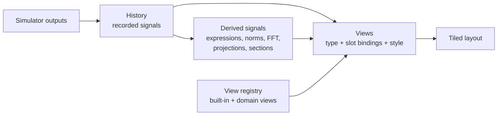

# Visualization architecture

_Last updated: 2026-10-17_

How the app turns a running model into pictures. Decision and rationale: [ADR 0015](../decisions/0015-pluggable-views.md). Status (2026-10-17): migration steps 1–3 are done. `crates/simsandbox-views` holds the history, the view contract and registry (`view.rs`), colour encodings (`colour.rs`) and the built-in views (`builtin.rs`, `view3d.rs`); the app shows the model's views as tiles in an automatic grid, with "More views…" for any other view that fits ([ADR 0016](../decisions/0016-model-curated-views.md); `crates/simsandbox-app/src/views.rs`). Derived signals, richer shapes, domain views and the viewer theme are planned (steps 4–6).



## Signals

A **signal** is a named quantity recorded over time.

| Kind | Example name | Source |
| --- | --- | --- |
| Scalar | `a.x`, `lorenz.xyz[0]`, `t` | An element of an output port, or time |
| Vector | `lorenz.xyz` | A whole vector output |
| Grid | `heat.temperature` | A grid output (planned kernel shape) |
| Point set | `flock.positions` | N points of dimension d (planned kernel shape) |
| Derived | `energy`, `fft(a.x)`, `pca(state)[0]` | Computed from other signals; presentation only |

Names follow the model file conventions: `block.port` for a whole output, `block.port[i]` for one element ([ADR 0014](../decisions/0014-view-in-controls.md)). The history records every signal at every communication step and is thinned, rewound and branched as a whole, so signals always pair by index.

Derived signals are defined in `controls` because they change only what is shown, never results. Expressions use the parser chosen for symbolic equation entry ([Q4](../open-questions.md)).

## Views

A view type declares:

| Part | Meaning | Example (`plot.phase`) |
| --- | --- | --- |
| Name | Namespaced like block types | `plot.xy` |
| Slots | Named inputs, each accepting some signal kinds; required or optional | `x`: one signal (default `t`), `y`: one or more, `colour`: one (optional) |
| Presets | Named starting bindings offered in "More views…" | "Plot against time", "Phase portrait" |
| Style properties | Declared like parameters: name, default, suggested range, description | `trail_length` (s; 0 no trail, -1 the whole run), `line_width` |
| Drawing | Draws from the bound signals into a region of the window | egui_plot line, or egui painter, or a wgpu paint callback |

Built-in types: `plot.xy` (any signals against time or each other, [ADR 0018](../decisions/0018-one-xy-plot.md)) and `plot.3d`; planned: `plot.heatmap` (grid over time or space), `plot.scatter` (point sets), `plot.spectrum`. Domain types: `eq.pendulum`, rigid-body scenes, field surfaces, agent maps.

Rendering technology follows the data size: egui_plot and the egui painter for lines up to tens of thousands of points; wgpu paint callbacks ([ADR 0008](../decisions/0008-native-egui-ui.md)) for meshes, fields and large point sets. GPU views are tested on software drivers ([development setup](../guides/development-setup.md#testing-gpu-code-without-a-gpu)).

## Style

| Layer | Who it serves | Where it lives | Examples |
| --- | --- | --- | --- |
| Encodings | The author: what the picture shows | Slot bindings in `controls` | Colour or opacity by `t` (trail fading), colour by speed |
| Style properties | The author: readability of this model | Declared per view type; values in `controls` | Trail length, point size, line width |
| Theme | The viewer | App settings, never in model files | Colour-blind-safe palette (default), light or dark, global line-width scale |
| Fixed defaults | Nobody needs to change them | Code | Grid style, marker shapes, fonts |

Rule for adding an option: it must change what can be read (make it a slot) or be needed for some model's readability (make it a style property), and an example or user need must show it. Purely aesthetic choices stay fixed.

## Default views

The views a model file lists are the views shown; any other view whose slots fit is one click away under "More views…", and domain views fit only their own block types ([ADR 0016](../decisions/0016-model-curated-views.md)). When a file names no views, the app opens the first preset that fits (a plot against time); with planned shapes and roles it picks from output shapes and roles: a 3-vector or three scalars with a position role give `plot.3d`; a grid gives `plot.heatmap`; a point set gives `plot.scatter`; otherwise `plot.time`. A domain can register a preferred view for its block types.

## Model file representation

```json
"controls": {
  "views": [
    { "type": "plot.3d",
      "bind": { "x": "lorenz.xyz[0]", "y": "lorenz.xyz[1]", "z": "lorenz.xyz[2]", "colour": "t" },
      "style": { "trail_length": 20.0 },
      "camera": { "yaw": -0.6, "pitch": 0.35, "zoom": 1.0 } },
    { "type": "plot.xy", "bind": { "x": "t", "y": ["lorenz.xyz[0]", "lorenz.xyz[2]"] } }
  ],
  "layout": "columns",
  "signals": { "energy": "0.5 * (a.v^2 + b.v^2)" }
}
```

`views` with `type`, `bind`, `style` and `camera` is implemented, one entry per tile in order; `layout` (tiles use an automatic grid for now) and `signals` are planned. A slot that takes one signal is written as a string, one that takes several as a list. Like the rest of `controls`, invalid entries are dropped with a warning ([ADR 0012](../decisions/0012-controls-in-model-files.md)). The older `controls.view` and the `plot.time` and `plot.phase` types are converted to `plot.xy` and `plot.3d` on load ([ADR 0018](../decisions/0018-one-xy-plot.md)).

## Crates

| Crate | Contents | Depends on |
| --- | --- | --- |
| `simsandbox-views` | History, view trait and registry, built-in views, colour encodings; later derived signals and the palette | egui, egui_plot (wgpu when the first GPU view lands) |
| Domain crates, feature `views` | Model-specific views, registered next to block types | `simsandbox-views` (optional) |
| `simsandbox-app` | Layout, panels, app settings | All of the above |

## Migration steps

1. Done 2026-10-16: move the history (`Session` series) and the three current views into `simsandbox-views` behind the view trait and registry.
2. Done 2026-10-16: replace `controls.view` with `controls.views` (the app saves the active view as one entry), keep reading `view`; a colour slot on `plot.phase` and `plot.3d` with trail fading as its default binding to `t` (so the phase portrait now fades too), and `trail_length` as the first style property, edited under "View" in the parameter panel.
3. Done 2026-10-17: several views at once in tiles (automatic grid, each tile with its own plot memory, slot pickers and close button), "More views…" for other fitting views, and Save writing all tiles ([ADR 0016](../decisions/0016-model-curated-views.md)).
4. Derived signals (expressions after Q4; norms, FFT, projections, Poincaré sections).
5. Grid and point-set shapes in the kernel, `plot.heatmap` and `plot.scatter`, with the first field or agent Block.
6. First domain view (`eq.pendulum`) with a pendulum example, proving the registration path.
