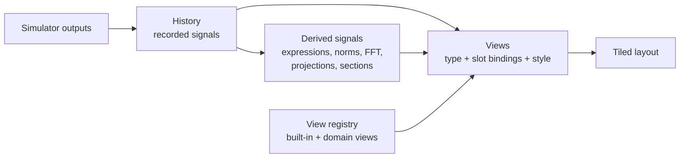

# Visualization architecture

_Last updated: 2026-10-22_

How the app turns a running model into pictures. Decision and rationale: [ADR 0015](../decisions/0015-pluggable-views.md). Status (2026-10-18): migration steps 1–6 are done. ADRs 0024 (heat map axes and coordinates), 0025 (index-aware settings), the filter layer (ADRs 0030–0032) and sweeps as samples (ADRs 0027–0028, for models without states) are built.

## Filters

Data flows sources → filters → views ([ADR 0030](../decisions/0030-filters-and-native-visualization.md)). Filters are saved in `controls.filters`; each has a `name`, a `type`, the `inputs` it reads and its settings, and the order carries no meaning ([ADR 0032](../decisions/0032-filters-as-a-graph.md)). They are evaluated with every recorded sample (`crates/simsandbox-app/src/filters.rs`, used by `Session`), so their results rewind, thin and branch with the history; editing them replays the recorded sources. Two types exist:

- `expression`: a derived signal over recorded signals, other expressions (evaluated in dependency order; cycles are dropped), parameters and `t`. The older `controls.signals` is converted on load.
- `cut` ([ADR 0031](../decisions/0031-cut-filters.md), `crates/simsandbox-views/src/cut.rs`): through one 2D grid, along x at fixed y values, along y at fixed x values, or along free lines (extended to the grid's edges by default), with bilinear or nearest interpolation. It records one line field per cut (`name[k]`, labelled e.g. `spring.c = 0.05`) and their shared coordinate (`name.x`, `name.y` or `name.fraction`). Profiles saved with ADR 0029 cuts are converted into cut filters on load.

The "Data…" window lists and edits all filters; a new cut filter opens a profile of its cuts. Filters that work on a window of history (FFT, smoothing, sections) are not built yet; they will not fit the per-sample evaluation and need their own path. The node canvas shows the same filters, and the views, as its data layer ([ADR 0050](../decisions/0050-data-layer-and-canvas-undo.md), `crates/simsandbox-session/src/observers.rs`), where they are wired, edited and promoted to model blocks. Field views are in `crates/simsandbox-views/src/fields.rs`. `crates/simsandbox-views` holds the history, the view contract and registry (`view.rs`), colour encodings (`colour.rs`) and the built-in views (`builtin.rs`, `view3d.rs`); the app shows the model's views as tiles in an automatic grid, with "More views…" for any other view that fits ([ADR 0016](../decisions/0016-model-curated-views.md); `crates/simsandbox-session/src/views.rs`). Derived signals and field recording are in `crates/simsandbox-session/src/session.rs` and `filters.rs`; views and the node canvas also render headless (`render.rs`, [ADR 0041](../decisions/0041-headless-interface.md)). The first domain view, `eq.pendulum`, lives in `crates/simsandbox-eq/src/views.rs` behind the crate's `views` feature. The viewer theme is planned.



## Signals

A **signal** is a named quantity recorded over time.

| Kind | Example name | Source |
| --- | --- | --- |
| Scalar | `a.x`, `lorenz.xyz[0]`, `spring.w`, `t` | An element of an output port; in a sweep, a swept parameter ([ADR 0028](../decisions/0028-sweeps-as-samples.md)); or the index `t`: time, or in a sweep the sample number |
| Vector | `lorenz.xyz` | A whole vector output |
| Grid | `rod.temperature` | A whole `Shape::Grid { nx, ny }` output, recorded as one frame per sample |
| Point set | `disc.positions` | A whole `Shape::Points { count, dim }` output (`[x0, y0, x1, y1, …]`), recorded as one frame per sample |
| Population | `sheep.position` | A `Shape::Population { dim }` output: points whose number varies, recorded as one frame per sample of its own length (`FieldShape::Population`); the history counts the values held when thinning, keeping at least 1000 samples |
| Derived | `energy`, `fft(a.x)`, `pca(state)[0]` | Computed from other signals; presentation only |

Names follow the model file conventions: `block.port` for a whole output, `block.port[i]` for one element ([ADR 0014](../decisions/0014-view-in-controls.md)). The history records every signal at every communication step and is thinned, rewound and branched as a whole, so signals always pair by index. Grids and point sets are recorded whole and are not split into scalars; when a model has fields, the history keeps at most 4 000 000 field values (but at least 1000 samples) before thinning. Derived signals cannot use fields yet.

Derived signals are defined in `controls.signals` because they change only what is shown, never results. Expressions use the typed-equation parser ([ADR 0017](../decisions/0017-typed-equations.md)) with dotted names: plotted signals (`a.v`, `lorenz.xyz[0]`), parameters (`a.kappa`) and `t`. They are evaluated with the parameter values current when each sample is recorded; redefining them recomputes the history with current values.

## Views

A view type declares:

| Part | Meaning | Example (`plot.phase`) |
| --- | --- | --- |
| Name | Namespaced like block types | `plot.xy` |
| Slots | Named inputs, each accepting one kind (scalar, grid or point set); required or optional | `x`: one signal (default `t`), `y`: one or more, `colour`: one (optional) |
| Presets | Named starting bindings offered in "More views…" | "Plot against time", "Phase portrait" |
| Style properties | Declared like parameters: name, default, suggested range, description | `trail_length` (s; 0 no trail, -1 the whole run), `line_width` |
| Drawing | Draws from the bound signals into a region of the window | egui_plot line, or egui painter, or a wgpu paint callback |

Built-in types: `plot.xy` (any signals against time or each other, [ADR 0018](../decisions/0018-one-xy-plot.md)), `plot.3d`, `plot.heatmap` (a field over two axes, [ADR 0024](../decisions/0024-heat-map-axes-and-coordinates.md), with an optional `points` slot that draws a point set's or population's newest points over the map in its coordinates, e.g. sheep on their grass: `x` and `y` each take `t` (for a line of cells) or a coordinate of the field; unbound axes take the remaining directions by cell number; a "swap axes" button exchanges them; coordinates may be unevenly spaced or decreasing, and are resampled so each cell reaches halfway to its neighbours; a 2D grid shows its newest frame; colours scaled to the shown values, linearly or with `log_colour` = 1 logarithmically), `plot.profile` (the newest frame of line fields against their coordinate, its value axis spanning every value seen so the curve moves, not the axis; cuts through 2D grids come from cut filters) `plot.scatter` (a point set's newest frame, first two coordinates), `plot.surface` and `plot.contour`; planned: `plot.spectrum`. Surfaces and contours take the heat map's slots and lay the field over its axes the same way (`fields::sheet`), so they show 2D grids over their coordinates and lines of cells over time: `plot.surface` draws heights in a box (axes normalised to [-1, 1], height to ±0.7) as quads coloured by value, shaded by slope and sorted furthest first (the painter's algorithm, at most 40 000 quads, outlined below 2 500), fitted to the current rotation, with the axis ranges in the labels; `plot.contour` draws `levels` lines evenly spaced strictly inside the value range by marching squares (linear interpolation along cell edges, saddles split by the cell mean, segments joined into lines), both with a `log_scale` style property. Domain types: `eq.pendulum` (the rod and bob, with a fading path); planned: rigid-body scenes, field surfaces, agent maps.

A view type may offer "swap axes" (`ViewType::swap`): a heat map exchanges its `x` and `y` bindings; `plot.xy`, whose `y` may hold several signals, draws transposed instead and saves that in its `selection`.

Coordinates are fields too: an output port may declare itself the coordinate of another output along a grid axis (`PortSpec::coordinate_of`; `eq.heat_rod` declares `position` for `temperature`), and in a two-parameter grid sweep the swept parameters' grids are coordinates of every result's grid. The history lists them (`History::coordinates`), axis pickers offer only `t` (for lines) and the bound field's coordinates, and a saved binding that cannot place the field is dropped with the reason. Slots and style properties declare where they apply (`applies`, [ADR 0025](../decisions/0025-index-aware-view-settings.md)); the panel hides the rest and views use their defaults there, so `trail_length` does nothing in sweeps. Views skip infinite and NaN values, leaving gaps (`finite_runs`). `plot.xy` and `plot.profile` span at least `MIN_RELATIVE_SPAN` (10⁻⁶) of the largest magnitude shown, so a conserved quantity is drawn flat rather than magnified to rounding noise; it is a fixed default, not a style property.

A sweep ([ADR 0028](../decisions/0028-sweeps-as-samples.md)) records one sample per point of its design, indexed by sample number, with the swept parameters as scalar signals beside the outputs and derived signals; sweep histories are never thinned. Only a grid over one parameter is ordered (`History::unordered` is false), so `plot.xy` draws lines; every other design is drawn as markers, coloured by value in bins when `colour` is bound. A grid over two parameters also holds whole-history fields (`History::add_whole`): every scalar signal reshaped as a grid named `grid.<signal>`, with `grid.<p0>` and `grid.<p1>` as coordinates, so heat maps and cut filters work on it; cut filters through these grids are computed once per sweep. Presets for sweeps: "Samples" (two swept parameters, coloured by the first result) and "Against the swept parameter"; a two-parameter grid opens on a heat map.

A view type lists the block types it applies to (`applies_to`, empty for generic views). A view that does not apply is neither offered under "More views…" nor restored from a file ([ADR 0016](../decisions/0016-model-curated-views.md)). What a model offers views is passed as `Available`: its scalar signals, grids, point sets and block types.

Rendering technology follows the data size: egui_plot and the egui painter for lines up to tens of thousands of points; wgpu paint callbacks ([ADR 0008](../decisions/0008-native-egui-ui.md)) for meshes, fields and large point sets. GPU views are tested on software drivers ([development setup](../guides/development-setup.md#testing-gpu-code-without-a-gpu)).

## Style

| Layer | Who it serves | Where it lives | Examples |
| --- | --- | --- | --- |
| Encodings | The author: what the picture shows | Slot bindings in `controls` | Colour or opacity by `t` (trail fading), colour by speed |
| Style properties | The author: readability of this model | Declared per view type; values in `controls` | Trail length, point size, line width |
| Theme | The viewer | App settings, never in model files | Colour-blind-safe palette (default), light or dark, global line-width scale |
| Fixed defaults | Nobody needs to change them | Code | Grid style, marker shapes, fonts |

Rule for adding an option: it must change what can be read (make it a slot) or be needed for some model's readability (make it a style property), and an example or user need must show it. Purely aesthetic choices stay fixed.

## Default views

The views a model file lists are the views shown; any other view whose slots fit is one click away under "More views…", and domain views fit only their own block types ([ADR 0016](../decisions/0016-model-curated-views.md)). When a file names no views, the app opens the first preset that fits, in registration order: a plot against time if the model records scalars, else a heat map for a grid, else a scatter plot for a point set. Planned: picking from output roles (a 3-vector with a position role gives `plot.3d`) and a domain's preferred view for its block types.

## Model file representation

```json
"controls": {
  "views": [
    { "type": "plot.3d",
      "bind": { "x": "lorenz.xyz[0]", "y": "lorenz.xyz[1]", "z": "lorenz.xyz[2]", "colour": "t" },
      "style": { "trail_length": 20.0 },
      "camera": { "yaw": -0.6, "pitch": 0.35, "zoom": 1.0 } },
    { "type": "plot.xy", "bind": { "x": "t", "y": ["lorenz.xyz[0]", "lorenz.xyz[2]"] } }
  ],
  "layout": "columns",
  "signals": { "energy": "0.5 * (a.v^2 + b.v^2)" }
}
```

`views` with `type`, `bind`, `style` and `camera`, one entry per tile in order, and `signals` are implemented; `layout` is planned (tiles use an automatic grid for now). A slot that takes one signal is written as a string, one that takes several as a list. Like the rest of `controls`, invalid entries are dropped with a warning ([ADR 0012](../decisions/0012-controls-in-model-files.md)). The older `controls.view` and the `plot.time` and `plot.phase` types are converted to `plot.xy` and `plot.3d` on load ([ADR 0018](../decisions/0018-one-xy-plot.md)).

## Crates

| Crate | Contents | Depends on |
| --- | --- | --- |
| `simsandbox-views` | History (signals and fields), view trait and registry, built-in views, colour encodings; later the palette | egui, egui_plot (wgpu when the first GPU view lands) |
| Domain crates, feature `views` | Model-specific views, registered next to block types (`simsandbox_eq::register_views`) | `simsandbox-views`, egui, egui_plot (optional) |
| `simsandbox-app` | Layout, panels, app settings | All of the above |

## Migration steps

1. Done 2026-10-16: move the history (`Session` series) and the three current views into `simsandbox-views` behind the view trait and registry.
2. Done 2026-10-16: replace `controls.view` with `controls.views` (the app saves the active view as one entry), keep reading `view`; a colour slot on `plot.phase` and `plot.3d` with trail fading as its default binding to `t` (so the phase portrait now fades too), and `trail_length` as the first style property, edited under "View" in the parameter panel.
3. Done 2026-10-17: several views at once in tiles (automatic grid, each tile with its own plot memory, slot pickers and close button), "More views…" for other fitting views, and Save writing all tiles ([ADR 0016](../decisions/0016-model-curated-views.md)).
4. Done 2026-10-17: derived signals as expressions (`controls.signals`, edited in the "Signals…" window) over plotted signals, parameters and `t`, recorded with every sample and recomputed for the whole history when redefined. Still to come: operations over history (FFT, smoothing, Poincaré sections), which approximate and so get methods ([ADR 0020](../decisions/0020-methods-for-approximations.md)).
5. Done 2026-10-17: `Shape::Grid` and `Shape::Points` in the kernel; the history records them as fields; `plot.heatmap` and `plot.scatter`; slots declare a kind; `eq.heat_rod` (a grid) and `eq.orbits` (a point set) with examples.
6. Done 2026-10-17: `eq.pendulum` block and its `eq.pendulum` view (`applies_to`), registered by `simsandbox-eq` behind its `views` feature, with a pendulum example.
