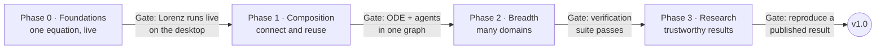

# Roadmap

_Last updated: 2026-10-23_

Start with the equation sandbox: it exercises the whole Block contract, delivers all three pillars at small scale, and is useful on its own. Each gate is a working demo, not a feature count. If a gate fails, fix the Block contract before adding any new backend, because every later phase depends on it.

Tick items here as they land; the current focus and order of work live in [STATUS.md](STATUS.md).

## Phase 0 · Foundations

Goal: one equation, live. Gate: the Lorenz system runs live on the desktop with sliders.

- [x] Block and capability-trait contract
- [x] SI units and checked connections
- [x] Kernel: model graph, co-simulation master, snapshots and rewind
- [x] Equation backend: Euler, RK4, Dormand–Prince 5(4), fusion of equation Blocks
- [x] Speed/accuracy labels on every method
- [x] Headless CLI
- [x] Model file format (load and save)
- [x] Desktop app shell (egui + wgpu)
- [x] Auto-generated parameter panel (typed entry, optional sliders) and live plots
- [x] Symbolic equation entry

## Phase 1 · Composition

Goal: connect and reuse. Gate: an ODE model and an agent model run in one graph (the grazing model: grass regrowing by an ODE, sheep agents eating it). Order and scope: [ADR 0038](decisions/0038-phase-1-revised.md) (revising [ADR 0033](decisions/0033-phase-1-plan.md) and [ADR 0036](decisions/0036-python-blocks.md)); every item meets [ADR 0039](decisions/0039-ai-agent-access.md) (AI agents as first-class users).

- [x] Pluggable views with slots, derived signals and multi-view layout ([ADR 0015](decisions/0015-pluggable-views.md)), built during Phase 0
- [x] Pause, rewind and branch in the UI, built during Phase 0
- [x] 1. Simulation on a worker thread ([ADR 0035](decisions/0035-simulation-worker-thread.md)), sliders live only for real-time models ([ADR 0037](decisions/0037-when-parameter-changes-apply.md))
- [x] 2. Kernel support for populations: tables and variable-length point sets ([ADR 0034](decisions/0034-agent-domain.md))
- [x] 3. Agent domain with a first agent model (grazing)
- [x] 4. Direct feedthrough and algebraic loops in fused groups
- [x] 5. Headless interface for people and AI agents: Python API (PyO3) with results as numpy arrays; `simsandbox describe`, `check` and `render` ([ADR 0039](decisions/0039-ai-agent-access.md); built 2026-10-22, [ADR 0041](decisions/0041-headless-interface.md))
- [x] 6. Visual node canvas: Diagram tab, block positions in the file, edits, start from a reached state, headless diagram images ([ADR 0042](decisions/0042-node-canvas.md); built 2026-10-22). Its data layer for filters and views ([ADR 0032](decisions/0032-filters-as-a-graph.md), [ADR 0050](decisions/0050-data-layer-and-canvas-undo.md)) and undo followed on 2026-10-23
- [x] 7. Subsystems collapsed into reusable Blocks: defined in the file, used by name, flattened on load; declared parameters with formulas ([ADR 0043](decisions/0043-subsystems.md); built 2026-10-23)
- [x] 8. Shareable model files: ask before discarding unsaved changes; a stated rule for older files, tested with fixtures ([ADR 0044](decisions/0044-unsaved-changes-and-older-files.md); built 2026-10-23)

## Phase 2 · Breadth

Goal: many domains. Gate: the verification suite passes for every backend.

- [ ] Rigid-body domain (MuJoCo)
- [ ] ML Blocks (ONNX Runtime)
- [ ] FMI 3.0 import and export
- [ ] Fast GPU fluids (real-time method)
- [ ] Co-simulation master with adaptive steps, coupling-error estimates, iteration and rollback
- [ ] Scheduled changes: parameter steps and disturbances at set times in the `run` section, so one run covers settling and a transient ([ADR 0042](decisions/0042-node-canvas.md))
- [ ] Physical (acausal) connections in the equation domain

## Phase 3 · Research

Goal: trustworthy results. Gate: reproduce a published result end to end.

- [ ] CFD/FEM batch runs (OpenFOAM, FEniCSx)
- [ ] Parameter sweeps and uncertainty quantification
- [ ] Provenance reports
- [ ] Cluster execution
- [ ] Standalone player app and explorables gallery
- [ ] AI model assistant
