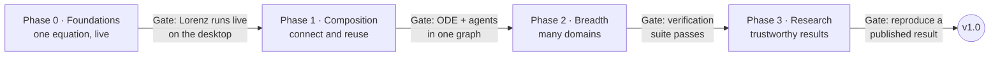

# Roadmap

_Last updated: 2026-10-15_

Start with the equation sandbox: it exercises the whole Block contract, delivers all three pillars at small scale, and is useful on its own. Each gate is a working demo, not a feature count. If a gate fails, fix the Block contract before adding any new backend, because every later phase depends on it.

Tick items here as they land; the current focus and order of work live in [STATUS.md](STATUS.md).

## Phase 0 · Foundations

Goal: one equation, live. Gate: the Lorenz system runs live on the desktop with sliders.

- [x] Block and capability-trait contract
- [x] SI units and checked connections
- [x] Kernel: model graph, co-simulation master, snapshots and rewind
- [x] Equation backend: Euler, RK4, Dormand–Prince 5(4), fusion of equation Blocks
- [x] Speed/accuracy labels on every method
- [x] Headless CLI
- [x] Model file format (load and save)
- [x] Desktop app shell (egui + wgpu)
- [x] Auto-generated parameter panel (typed entry, optional sliders) and live plots
- [ ] Symbolic equation entry

## Phase 1 · Composition

Goal: connect and reuse. Gate: an ODE model and an agent model run in one graph.

- [ ] Visual node canvas
- [ ] Python API (PyO3)
- [ ] Subsystems collapsed into reusable Blocks
- [ ] Pause, rewind and branch in the UI
- [ ] Shareable model files
- [ ] Agent domain (ECS) with a first agent model
- [ ] Direct feedthrough and algebraic loops in fused groups

## Phase 2 · Breadth

Goal: many domains. Gate: the verification suite passes for every backend.

- [ ] Rigid-body domain (MuJoCo)
- [ ] ML Blocks (ONNX Runtime)
- [ ] FMI 3.0 import and export
- [ ] Fast GPU fluids (real-time method)
- [ ] Co-simulation master with adaptive steps, coupling-error estimates, iteration and rollback
- [ ] Physical (acausal) connections in the equation domain

## Phase 3 · Research

Goal: trustworthy results. Gate: reproduce a published result end to end.

- [ ] CFD/FEM batch runs (OpenFOAM, FEniCSx)
- [ ] Parameter sweeps and uncertainty quantification
- [ ] Provenance reports
- [ ] Cluster execution
- [ ] Standalone player app and explorables gallery
- [ ] AI model assistant
